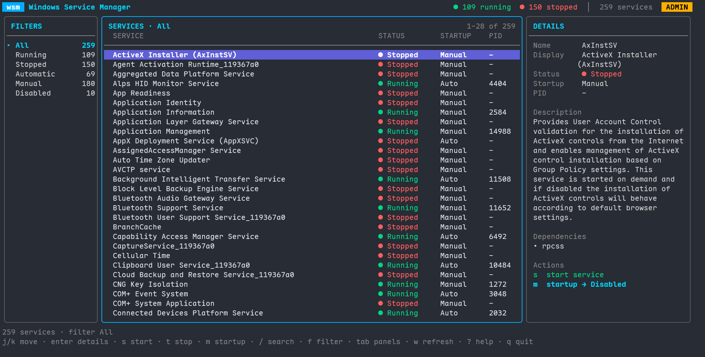

# Windows Service Manager (TUI)

> A modern, terminal-based Windows service management tool built with Go and Bubble Tea

[](https://golang.org/)
[](https://www.microsoft.com/windows/)
[](LICENSE)

## Overview

Windows Service Manager is a powerful TUI (Terminal User Interface) replacement for the traditional Windows Services management console (`services.msc`). Built with Go and the elegant Bubble Tea framework, it provides a modern, keyboard-driven interface for managing Windows services efficiently.



## ✨ Features

### 🎯 Core Service Management
- **Start/Stop services** with immediate execution
- **Change startup type** (Automatic/Manual/Disabled) instantly
- **Real-time status updates** with auto-refresh
- **Detailed service information** including PID, startup type, and dependencies
- **Administrator privilege handling** with graceful error management

### 🎨 Modern Terminal Interface
- **Lazydocker-style TUI** with filter sidebar, service table, and live details pane
- **Automatic UAC elevation** on startup (like `sudo`), with `-no-elevate` opt-out
- **Vim-style navigation** for efficient keyboard control
- **Responsive design** that adapts to terminal size
- **Color-coded status indicators** for quick visual feedback

### ⚡ Advanced Capabilities
- **Powerful search** across service names and descriptions
- **Flexible filtering** (All/Running/Stopped/Manual/Disabled/Automatic)
- **YAML configuration** with sensible defaults
- **Structured logging** with configurable levels

## 🚀 Quick Start

### Prerequisites
- Windows 10 or 11
- Administrator privileges for service changes (the app requests them automatically via UAC)

### Installation

```bash
# Clone the repository
git clone https://github.com/rifqiabd/win-service-manager.git
cd win-service-manager

# Build the executable
go build -o win-service-manager.exe .
```

### Scoop

```powershell
scoop bucket add rifqiabd https://github.com/rifqiabd/scoop-bucket
scoop install rifqiabd/win-service-manager
wsm -version
```

To update or remove the application:

```powershell
scoop update win-service-manager
scoop uninstall win-service-manager
```

The application is portable and does not install a Windows service. On startup it requests administrator privileges through the UAC prompt. Use `-no-elevate` to browse services without elevation.

### Creating a Release

Create and push a semantic version tag from the fork repository. GitHub Actions builds a Windows amd64 ZIP archive and publishes it as a GitHub Release.

```bash
git tag v1.1.0
git push origin v1.1.0
```

### Usage
```bash
# Run with default settings (prompts for UAC)
.\win-service-manager.exe

# Use custom configuration
.\win-service-manager.exe -config myconfig.yaml

# Browse without the UAC prompt
.\win-service-manager.exe -no-elevate

# Enable debug logging
.\win-service-manager.exe -log-level debug
```

## ⌨️ Keyboard Shortcuts

### Navigation
| Key | Action |
|-----|--------|
| `j` / `↓` | Move down |
| `k` / `↑` | Move up |
| `g` / `G` | Go to top / bottom |
| `n` / `PgDn` | Page down |
| `p` / `PgUp` | Page up |
| `Tab` / `←` / `→` | Switch focus between services and filters |
| `1` - `6` | Jump directly to a filter |

### Service Actions
| Key | Action |
|-----|--------|
| `Enter` | Open service details |
| `s` | Start service |
| `t` | Stop service |
| `m` | Change startup type |

### View Controls
| Key | Action |
|-----|--------|
| `w` / `F5` | Refresh services |
| `f` | Cycle filter (All/Running/Stopped/Automatic/Manual/Disabled) |
| `/` | Live search |
| `h` / `?` | Toggle help |
| `Esc` | Go back / Clear search |
| `q` / `Ctrl+C` | Quit |

### Search Mode
| Key | Action |
|-----|--------|
| `Enter` | Keep search and exit search mode |
| `Esc` | Exit search mode and clear the query |
| `Backspace` | Delete last character |
| Any letter/number | Filter the list live as you type |

## ⚙️ Configuration

Create `~/.config/win-service-manager/config.yaml`:

```yaml
display:
  services_per_page: 25
  show_descriptions: true
  show_process_ids: true
  theme: "auto"
  refresh_interval: 5

logging:
  level: "info"
  enable_console: true

services:
  default_filter: "all"    # Options: all, running, stopped, manual, disabled, automatic
  show_system_services: true

behavior:
  confirm_stop: false        # All operations execute immediately
  confirm_restart: false     # (Note: restart not implemented)
  auto_refresh: true
```

## 🏗️ Architecture

```
win-service-manager/
├── main.go                    # Application entry point
├── internal/
│   ├── service/              # Windows service management
│   │   └── manager.go       # SCM interface & operations  
│   ├── config/              # Configuration handling
│   │   └── config.go        # YAML config management
│   ├── logging/             # Structured logging
│   │   └── logger.go        # slog integration
│   └── ui/                  # Terminal interface
│       ├── model.go         # Bubble Tea state management
│       ├── view.go          # UI rendering with Lip Gloss
│       └── commands.go      # Async operations & messages
├── go.mod                   # Go module definition
└── sample-config.yaml       # Example configuration
```

## 📋 Requirements

- **OS**: Windows 10/11 
- **Go**: 1.21+ (for building from source)
- **Dependencies**:
  - [Bubble Tea](https://github.com/charmbracelet/bubbletea) - TUI framework
  - [Lip Gloss](https://github.com/charmbracelet/lipgloss) - Terminal styling
  - [golang.org/x/sys/windows](https://pkg.go.dev/golang.org/x/sys/windows) - Windows API

## 🔒 Security

- Requests administrator privileges through the Windows UAC prompt on startup
- `-no-elevate` allows read-only browsing without elevation
- Operations execute immediately for efficiency
- Safe service operation timeouts
- Comprehensive error handling and logging

## 🐛 Troubleshooting

### Common Issues

**Access Denied Errors**
- Accept the UAC prompt when the app starts
- If you launched with `-no-elevate`, restart without it to manage services

**UAC prompt does not appear**
- Check that UAC is enabled in Windows settings
- Run `wsm` from a normal terminal (not an already-elevated one)

**Services Not Loading**  
- Ensure Windows Service Control Manager is accessible
- Try running with administrator privileges

**Configuration Issues**
- Delete config file to reset to defaults: `~/.config/win-service-manager/config.yaml`

## Contributing
We welcome contributions from the community. If you have ideas, bug reports, or feature requests, please open an issue or submit a pull request.

## License
This project is licensed under the MIT License.